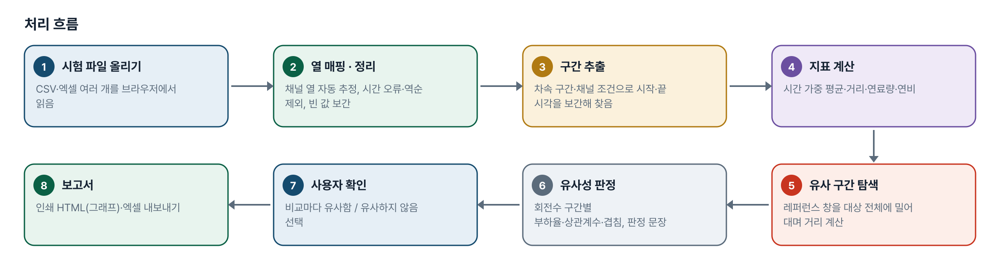
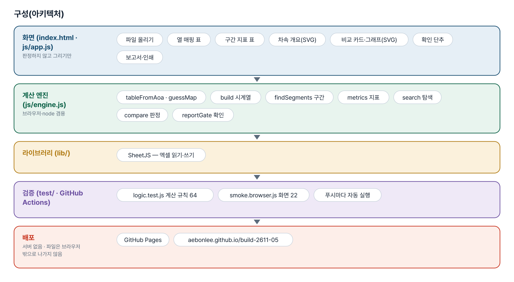
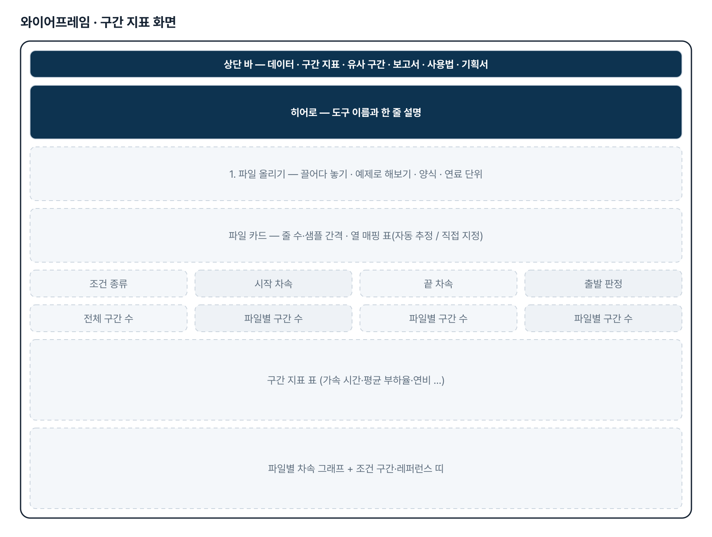
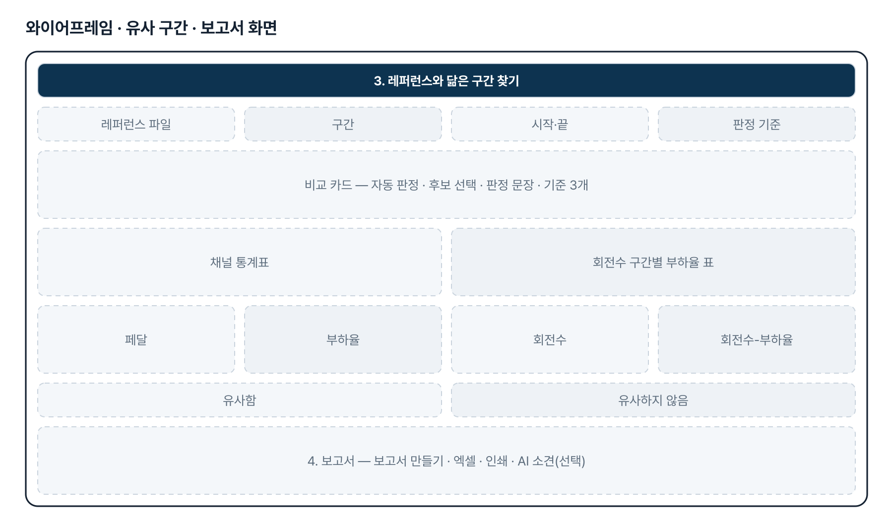
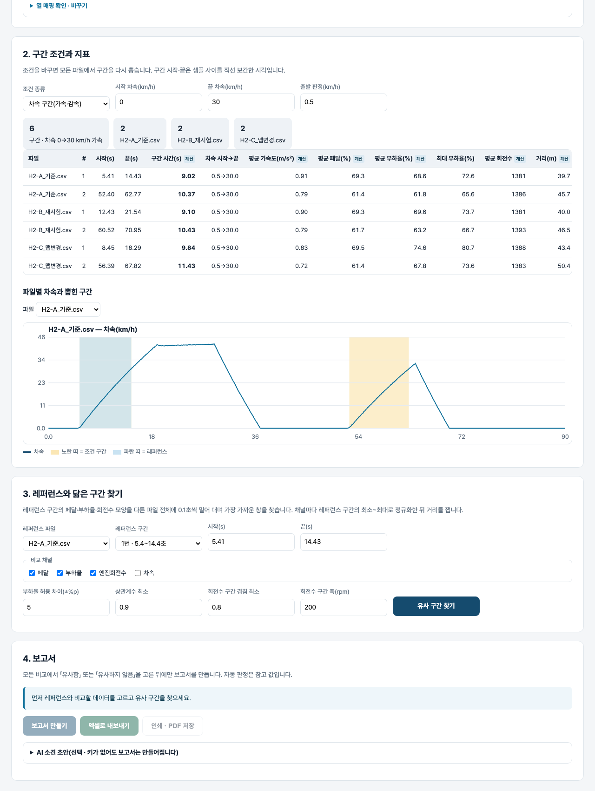

# 시험 데이터 비교 보고서 — 프로젝트 기획서 v1.0

- 기획: Hyunwoo Park · 작성일 2026-11-02 · 생성형 AI 업무자동화 전문가과정 · 2차수 프로젝트 05
- 바로 쓰기: https://build-2611-05.jobability.co.kr/
- 워드 판: `docs/기획서/build-2611-05_HyunwooPark_시험데이터비교보고서_기획서_v1.0.docx`

## 개요

차량 시험 raw data(CSV·엑셀)를 올리면 조건 구간(예: 차속 0→30 km/h 가속)의 가속 시간·평균 부하율·연비를 한 번에 계산하고, 레퍼런스와 페달·부하율·회전수 패턴이 닮은 구간을 찾아 유사성 지표로 비교한 뒤, 사용자가 유사 여부를 확인하면 그래프가 들어간 보고서(인쇄·엑셀)를 만드는 도구입니다.

### 배경 · 현재 업무
- 수소연소엔진 탑재 차량의 제어기 파라미터를 캘리브레이션하며 차량 시험 raw data를 반복해서 분석합니다.
- 0→30 km/h 가속 시간·평균 부하율·연비처럼 같은 조건의 지표를 파일마다 손으로 구간을 잘라 계산합니다.
- 새 시험 데이터가 레퍼런스와 비슷한 조건인지(페달·부하율·회전수) 판단할 정량 근거가 없습니다.
- 비교 결과를 그래프가 들어간 보고서로 정리하는 데 시간이 듭니다.

### 목표
- 사용자가 정한 조건으로 모든 파일에서 구간을 뽑고 지표를 한 번에 계산합니다.
- 레퍼런스 구간과 닮은 구간을 다른 데이터에서 자동으로 찾습니다.
- 회전수 구간별 부하율 차이·상관계수 같은 유사성 지표와 판정 문장을 제시합니다.
- 사용자가 유사 여부를 확인한 뒤에만 보고서(인쇄 HTML·엑셀)를 만듭니다.

## 요구사항과 구현

| 기획서 요구 | 구현 |
|---|---|
| 시험 raw data 기반 분석 | CSV(UTF-8·EUC-KR)·엑셀 첫 시트, 제목 줄·단위 줄 자동 처리, 여러 파일 동시 |
| 페달·부하율·회전수 등 판별 | 열 매핑 표(자동 추정 / 직접 지정 표시), 한글·영문 약어 별칭 |
| 사용자 지정 criteria | 차속 구간(가속·감속, 출발 판정 차속) · 채널 조건 지속(예: 페달 ≥60% 1초 이상) |
| 0→30kph 가속 시간·평균 부하율·연비 동시 계산 | 구간 시간·평균 가속도·평균/최대 페달·부하율·회전수·거리·연료량·연비(시간 가중, 끝점 보간) |
| 레퍼런스 1개 지정 → 유사 구간 추출 | 0.1초 격자로 다시 표본화, 레퍼런스 범위 정규화 후 슬라이딩 창 거리, 겹치지 않는 후보 3개 |
| 유사성 지표(「xx% 이내 수렴」) | 회전수 구간별 부하율 차이(평균·최대)·허용 이내 비율·상관계수 최소·구간 겹침 → 판정 문장 |
| 보고서 전 사용자 확인 | 비교마다 「유사함 / 유사하지 않음」을 골라야 보고서 버튼이 열림, 자동 판정과 다르면 표시 |
| 그래프 포함 보고서 | 화면 보고서(인쇄·PDF), 엑셀(구간지표·유사도판정·회전수구간_부하율·정렬 데이터) |

## 주요 기능

- **파일 읽기 · 열 매핑** — CSV·엑셀을 여러 개 읽고 시간·차속·페달·부하율·회전수·연료유량 열을 자동으로 고릅니다. 틀린 줄과 보간한 빈 값은 알립니다.
- **구간 지표** — 차속 구간 또는 채널 조건으로 구간을 뽑고 가속 시간·평균 부하율·연비 등을 표로 보여 줍니다. 계산한 값은 「계산」으로 표시합니다.
- **유사 구간 찾기** — 레퍼런스 구간의 페달·부하율·회전수 모양을 다른 파일 전체에 밀어 대며 가장 가까운 창 3개를 찾습니다.
- **유사성 판정** — 회전수 구간별 부하율 차이, 상관계수, 구간 겹침 세 기준으로 자동 판정하고 문장으로 설명합니다.
- **사용자 확인** — 비교마다 유사 여부를 직접 고릅니다. 후보 창을 바꾸면 다시 확인합니다.
- **보고서 · 엑셀** — 그래프가 들어간 화면 보고서를 인쇄·PDF로, 지표·판정·정렬 데이터를 엑셀로 냅니다. AI 소견 초안은 선택입니다.

## 처리 흐름(파이프라인)

1. **시험 파일 올리기** — CSV·엑셀 여러 개를 브라우저에서 읽음
2. **열 매핑 · 정리** — 채널 열 자동 추정, 시간 오류·역순 제외, 빈 값 보간
3. **구간 추출** — 차속 구간·채널 조건으로 시작·끝 시각을 보간해 찾음
4. **지표 계산** — 시간 가중 평균·거리·연료량·연비
5. **유사 구간 탐색** — 레퍼런스 창을 대상 전체에 밀어 대며 거리 계산
6. **유사성 판정** — 회전수 구간별 부하율·상관계수·겹침, 판정 문장
7. **사용자 확인** — 비교마다 유사함 / 유사하지 않음 선택
8. **보고서** — 인쇄 HTML(그래프)·엑셀 내보내기

## 구성(아키텍처)

- **화면 (index.html · js/app.js)** — 파일 올리기 · 열 매핑 표 · 구간 지표 표 · 차속 개요(SVG) · 비교 카드·그래프(SVG) · 확인 단추 · 보고서·인쇄
- **계산 엔진 (js/engine.js)** — tableFromAoa · guessMap · build 시계열 · findSegments 구간 · metrics 지표 · search 탐색 · compare 판정 · reportGate 확인
- **라이브러리 (lib/)** — SheetJS — 엑셀 읽기·쓰기
- **검증 (test/ · GitHub Actions)** — logic.test.js 계산 규칙 64 · smoke.browser.js 화면 22 · 푸시마다 자동 실행
- **배포** — GitHub Pages · aebonlee.github.io/build-2611-05

## 화면 구성(와이어프레임)

## 규칙 · 판정 기준

- 차속 구간 시작은 시작값을 지나는 순간(0 이면 출발 판정 0.5 km/h), 끝은 끝값에 처음 닿는 순간 — 샘플 사이 직선 보간.
- 끝값에 닿기 전에 다시 시작값 아래로 내려가면 그 시도는 버립니다.
- 평균은 시간 가중(사다리꼴 적분 ÷ 구간 시간). 연비 = ∫차속 dt ÷ ∫연료유량 dt.
- 탐색 정규화는 레퍼런스 구간의 최소~최대 — 부하율이 통째로 높아진 차이도 드러납니다.
- 판정: 부하율 차이 최대 ≤ ±5%p · 상관계수 최소 ≥ 0.9 · 회전수 구간 겹침 ≥ 80% 모두 만족이면 유사.
- 모든 비교의 유사 여부를 사용자가 골라야 보고서를 만듭니다.

## 검증

- 계산 규칙 테스트 64개 · 화면 연기 테스트 22개 통과
- 가다 멈춘 시도 버리기·후보 겹침 제외·미확인 검사를 일부러 지우면 각각 테스트가 실패합니다.
- 화면 테스트: 예제 → 6구간 → 유사 구간 찾기 → B 유사·C 유사하지 않음 → 확인 → 보고서·엑셀 → 360px 넘침(넓은 글꼴 포함).

## 이번 판에서 하지 않는 것

- 기획2(수천 쪽 제어기 매뉴얼 기반 고장 진단)는 대용량 문서 RAG라 이번 판 범위 밖이며 DAY4 실습에서 축소판으로 다룹니다.
- 속도가 다른 시험을 시간 축으로 늘이고 줄여 맞추기(DTW)는 하지 않습니다 — 같은 길이 창끼리 비교합니다.
- 계측 장비 원본 형식(MDF·BLF 등)은 읽지 않습니다 — CSV·엑셀로 내보내 올립니다.

## 다음 단계

- 실데이터 양식에 맞춘 열 별칭·기본 허용치 협의
- 같은 조건 구간끼리 바로 비교하는 모드
- DTW 정렬, 여러 레퍼런스 저장
- 사내 보고서 양식(표지·결재란) 맞춤

## 버전 이력

- **v1.0** (2026-11-02) — 첫 판 — 열 매핑·구간 지표·유사 구간 탐색·유사성 판정·사용자 확인·보고서(인쇄·엑셀) / 기획서 워드 판·파이프라인·아키텍처·와이어프레임 추가
